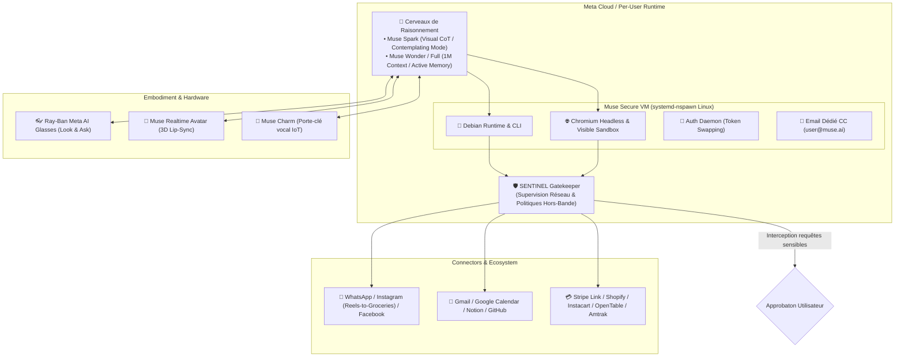
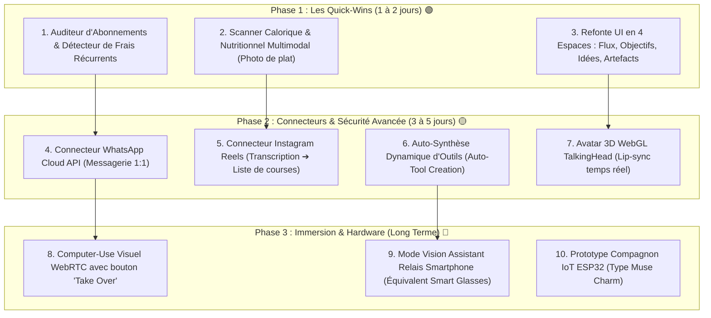

# 🌌 Rapport Comparatif Exhaustif : Meta Muse (Muse AI) vs HoL AI

> **Projet :** House of Legends AI (HoL AI)  
> **Sujet d'étude :** Meta Muse (Famille Muse Spark / Muse Wonder & Écosystème Agentique Meta)  
> **Sources analysées :** Meta Connect 2026, Meta Superintelligence Labs (MSL), Reddit (r/ArtificialInteligence, r/singularity, r/AI_Agents), YouTube Tech Reviews, TikTok Viral Demos, Vellum AI, Datacamp, Kodem Security  
> **Date :** 25 Octobre 2026  
> **Auteur :** Antigravity & Yassir  

---

## 1. 🎯 Introduction & Contexte du Phénomène Meta Muse

Lancé en septembre 2026 par Meta Platforms sous l'égide de **Meta Superintelligence Labs (MSL)** et propulsé sur le devant de la scène lors de **Meta Connect 2026**, **Meta Muse** (souvent abrégé en **Muse**) a marqué un tournant historique dans l'IA grand public : le passage des chatbots conversationnels passifs (type ChatGPT / ancien Meta AI) à des **agents personnels autonomes orientés objectifs (Goal-Driven Autonomous Agents)**.

Grâce à ses démonstrations virales sur TikTok et YouTube (notamment la détection d'abonnements oubliés économisant plus de 1 000 $/an et la réservation autonome multi-étapes), Muse est rapidement monté en tête des classements applicatifs.

### Les 4 Piliers Fondamentaux de Meta Muse :
1. **L'Approche par Objectif (Goal-Oriented) :** On ne dicte plus chaque étape à l'IA ; on lui confie une finalité (ex: *"Trouve un créneau libre vendredi soir dans mon agenda, vérifie les trains et réserve une table pour 4"*), et l'agent planifie et exécute les sous-tâches.
2. **L'Arrière-Plan Permanent ("Bot Mode") :** L'agent continue d'opérer dans le cloud même lorsque l'application ou le smartphone est éteint.
3. **L'Isolation Sécurisée (Muse Secure VM + Sentinel) :** Chaque utilisateur dispose d'une machine virtuelle Linux isolée avec un gardien hors-bande (Sentinel) empêchant les fuites de données et exigeant une validation humaine pour les dépenses ou messages.
4. **L'Incarnation Multimodale & Matérielle :** Intégration directe dans les lunettes connectées Ray-Ban Meta ("Look and Ask"), un avatar 3D temps réel, et un porte-clé physique dédié (*Muse Charm*).

---

## 2. 🔬 Anatomie Technique Complète de Meta Muse

### A. Les Modèles de Raisonnement (The Brains)
- **Muse Spark :** Modèle agentique natif orienté action, navigation CLI, raisonnement visuel pas-à-pas (Visual Chain-of-Thought) et orchestration multi-agents (*Contemplating Mode*).
- **Muse Wonder & Wonder Full :** Modèles frontières entraînés sur le supercalculateur Prometheus. Fenêtre de contexte de **1 048 576 tokens (~1M)**, capable d'ingérer texte, images, vidéos, flux audio et PDF juridiques ou financiers volumineux.
  - *Active Memory :* Mémoire sémantique permanente entre conversations distinctes (habitudes, préférences alimentaires, seuils budgétaires).
  - *Active Focus :* Persistance sur les tâches de longue durée avec auto-correction en cas d'échec d'une étape.
- **Muse Image & Muse Video :** Génération visuelle par synthèse de code (plots, QR codes interactifs) et génération vidéo multimodale synchronisée avec l'audio.

### B. L'Infrastructure d'Exécution (The Body)
- **Muse Secure VM :** Conteneur Linux isolé (`systemd-nspawn`) provisionné par utilisateur. Héberge un stockage persistant, un environnement Python/Bash et un navigateur Chromium dédié.
- **Computer-Use & Navigation Web Autonome :** L'agent navigue sur des sites non dotés d'API (formulaires administratifs, billetterie ferroviaire, e-commerce).
- **Contrôle Visuel & "Take Over" :** L'utilisateur peut visionner en temps réel le curseur de l'IA sur la page et cliquer sur *"Take Over"* pour reprendre la main à tout moment, ou *"Stop"* pour interrompre l'action.
- **Adresse Email Dédiée CC :** Chaque utilisateur a une adresse alias (`pseudo@muse.ai`). Il suffit de mettre Muse en copie d'une réservation ou d'un billet pour que l'agent l'ajoute à l'agenda et surveille les retards.

### C. Sécurité & Gouvernance (The Shield)
- **Sentinel (Gardien Hors-Bande) :** Démon indépendant fonctionnant en dehors du flux principal du LLM. Il inspecte tout le trafic réseau sortant pour bloquer les attaques par injection indirecte (ex: instructions cachées dans un email ou une page web hostile).
- **Token Swapping & Coffre-Fort Sécurisé :** Le modèle n'a jamais accès aux mots de passe en clair ni aux vrais numéros de carte bancaire. Les connexions s'effectuent par échange de jetons chiffrés.
- **Cartes Virtuelles Éphémères (Stripe Link) :** Pour tout paiement validé par l'humain, Muse génère un numéro de carte bancaire virtuelle à usage unique plafonné au montant exact.

### D. Connecteurs Applicatifs
- **Meta Native :** WhatsApp (conversation 1:1 pour commander l'agent), Instagram (extraction d'une recette depuis un Reel sauvegardé pour générer un panier d'ingrédients, réponse aux messages d'entreprises).
- **Productivité :** Google Workspace (Gmail, Calendar), Notion, GitHub.
- **Commerce & Vie Quotidienne :** Instacart (courses alimentaires), OpenTable (restaurants), Amtrak (trains), Expedia (vols/hôtels), Shopify.
- **Audit d'Abonnements :** Analyse des relevés bancaires et emails pour identifier les prélèvements récurrents oubliés et préparer les lettres de résiliation.
- **Suivi Santé / Calories :** Détection d'aliments et calcul calorique à partir de photos de repas.
- **Synthèse Dynamique d'Outils (Self-Synthesizing) :** Si aucune API n'existe, Muse code son propre connecteur en direct ou passe par le navigateur virtuel.

### E. Matériel & Interfaces
- **Ray-Ban Meta / Oakley Smart Glasses :** Utilisation mains-libres en commande vocale et vision en direct ("Look and Ask").
- **Muse Realtime Avatar :** Avatar animé 3D avec synchronisation labiale et expressions émotionnelles.
- **Muse Charm :** Boîtier physique porte-clé connecté (sortie fin 2026) avec micro/haut-parleur pour solliciter l'IA sans sortir son smartphone.
- **Interface à 4 Onglets :** *Flux (Feed)* pour suivre les tâches de fond, *Objectifs (Goals)* pour configurer ses projets de vie/travail, *Idées (Ideas)* pour les suggestions proactives, et *Artefacts* pour retrouver ses documents.

---

## 3. ⚔️ Matrice de Comparaison : HoL AI vs Meta Muse

| Domaine Fonctionnel | Fonctionnalité Clé | Meta Muse | HoL AI (Actuel) | Statut HoL AI |
| :--- | :--- | :---: | :---: | :---: |
| **Raisonnement IA** | Moteur Re-Act autonome & Tool Calling | Muse Spark / Wonder | Gemini 3.5 / 3.8 (`CognitiveAgentEngine`) | ✅ **Présent** |
| | Mémoire multi-tours & résolution d'anaphores | Active Memory | `SessionManager` + Historique fenêtré | ✅ **Présent** |
| | Génération d'artefacts (Markdown, Mermaid, Apps) | Onglet Artifacts | `ArtifactsUIAgent` + Studio `/artifacts` | ✅ **Présent** |
| | Multi-Agents parallèles en contexte isolé | Contemplating Mode | `SubagentOrchestratorAgent` (`asyncio.gather`) | ✅ **Présent** |
| **Système & Code** | Opérations de code chirurgicales (`edit_file`) | Oui (via Cloud VM) | `DevCodeAgent` (1-based lines, diff exact) | ✅ **Présent** |
| | Exécution Terminal & Gestion de Processus | Bash / Linux VM | `ShellExecutionAgent` (PowerShell/Bash + supervision) | ✅ **Présent** |
| | Contrôle universel d'applications OS (Desktop) | macOS / Web | `AppLauncherService` (Toutes applis Windows/UWP) | ✅ **Présent (Supérieur sur Win32/UWP)** |
| **Web & E-Commerce** | Recherche web temps réel | Virtuel Browser | `WebResearchAgent` (`ddgs` + reader propre) | ✅ **Présent** |
| | Chasse aux prix multi-plateformes | Partenaires US | `ProductHunter` + `OmniScraper` (Amazon, Cdiscount, Fnac, LBC...) | ✅ **Présent (Spécialisé FR)** |
| | Seconde main & reconditionné | Limité | `SecondHandHunter` (Leboncoin, BackMarket) | ✅ **Présent (Exclusif HoL AI)** |
| **Sécurité & HITL** | Validation humaine avant achat (Human-in-the-Loop) | Checkpoint Stripe | `secure_vault.py` (Validation 1-clic cryptée) | ✅ **Présent** |
| | Processus de sécurité Sentinel hors-bande | Démon dédié | Filtrage intégré dans le shell & vault | 🟡 **Partiel** |
| | Cartes bancaires virtuelles éphémères | Stripe Link | Simulation de signature Enclave VM | ❌ **Non Présent** |
| **Proactivité & Hub** | Veille d'arrière-plan autonome (Background tasks) | Bot Mode Cloud | `background_watcher.py` (loop daemon) | ✅ **Présent** |
| | Briefing quotidien (Météo, Mails, Agenda, MRR) | Résumé matinal | `jarvis_briefing.py` (Jarvis Hub complet) | ✅ **Présent** |
| | Suivi logistique de colis | Connecteurs US | `agent_3_logistics` (Colissimo, Chronopost, DHL...) | ✅ **Présent** |
| | Suivi financier & métriques business | Finance connectors | `agent_4_finance` (Stripe MRR, TVA, Marges) | ✅ **Présent** |
| **Connecteurs Comms** | Passerelle Telegram | Non (uniquement Meta) | `telegram_gateway.py` | ✅ **Présent (Exclusif HoL AI)** |
| | Intégration WhatsApp officielle | Native | Non configurée | ❌ **Non Présent** |
| | Ingestion Reels Instagram ➔ Panier courses | Native | Non configurée | ❌ **Non Présent** |
| | Adresse email dédiée en copie (`@hol-ai`) | Alias `@muse.ai` | Non configurée | ❌ **Non Présent** |
| **Vie Quotidienne** | Audit automatisé d'abonnements oubliés | Star Demo YouTube | Non implémenté | ❌ **Non Présent** |
| | Scanner calorique de repas par photo | Multimodal Vision | Non implémenté | ❌ **Non Présent** |
| **Interface & Visual** | Computer-Use visuel avec bouton "Take Over" | Stream WebRTC VM | `browser_sandbox.py` (local/headless) | ❌ **Non Présent** |
| | Avatar 3D expressif synchronisé sur la voix | Realtime Avatar | Cartes visuelles & HUD Cyberpunk | ❌ **Non Présent** |
| | Organisation UI en 4 onglets (Flux, Buts, Idées, Artefacts) | Onglets dédiés | Vue Chat + Sidecar + Cartes réactives | ❌ **Non Présent** |
| **Matériel & IoT** | Intégration lunettes connectées (Ray-Ban Meta) | Native | Non implémenté | ❌ **Non Présent** |
| | Boîtier physique porte-clé dédié (*Muse Charm*) | Matériel Meta | Non implémenté | ❌ **Non Présent** |
| | Synthèse dynamique d'outils à chaud | Oui | Scripting manuel via `DevCodeAgent` | 🟡 **Partiel** |

---

## 4. 🏆 Ce que HoL AI Possède Déjà (Forces & Parité Réussie)

Grâce aux récents développements, HoL AI n'a rien à envier à Meta Muse sur le cœur d'ingénierie et d'automatisation :
1. **L'Autonomie Cognitive Complète :** Le moteur `CognitiveAgentEngine` orchestre 18 outils en chaîne fermée Re-Act.
2. **Le Contrôle OS Local Direct :** Contrairement à Muse qui est enfermé dans une VM cloud et ne peut pas manipuler le PC physique de l'utilisateur sans agent lourd, HoL AI pilote nativement **absolument toutes les applications Windows** (Steam, Lenovo Vantage, Discord, Explorer, Calculatrice, Chrome...) via `AppLauncherService`.
3. **L'Ingénierie Logicielle de Pointe :** Avec les agents Parity (`DevCodeAgent`, `ShellExecutionAgent`, `SystematicDebuggerAgent`, `ArchitectPlannerAgent`), HoL AI est capable de coder, déboguer et refactorer son propre code source, ce que Muse réserve à un usage très encadré.
4. **L'Ancrage E-Commerce Local & Seconde Main :** Là où Muse est très focalisé sur les géants américains (Amazon, Instacart), HoL AI dispose de scrapers sur-mesure pour la France (Leboncoin, BackMarket, Cdiscount, Fnac).
5. **Le Contrôle Mobile Décentralisé :** Grâce à `telegram_gateway.py` et le dashboard Web responsive (`index.html`), HoL AI est accessible depuis n'importe quel smartphone sans dépendre de l'écosystème de Meta.

---

## 5. 🔍 Analyse Exhaustive des Fonctionnalités Manquantes & Difficulté d'Intégration dans HoL AI

Pour que HoL AI surpasse totalement Meta Muse, voici les **12 fonctionnalités non présentes**, analysées avec leur niveau de difficulté et leur plan d'implémentation :

---

### 🟢 1. L'Auditeur Automatisé d'Abonnements (Subscription & Bill Auditor)
- **Description :** C'est la fonctionnalité star des démos virales de Muse sur TikTok et YouTube. L'agent analyse les relevés de compte (PDF, CSV) ou les emails de facturation, isole les prélèvements périodiques récurrents (SaaS, salle de sport, streaming, assurances), calcule la dépense annuelle cumulée et propose un bouton "Résilier" générant automatiquement la lettre de résiliation conforme à la loi française (Loi Hamon / Châtel).
- **Difficulté :** 🟢 **FACILE**
- **Prérequis Techniques :** Bibliothèque Python `pypdf` ou `pdfplumber`, analyse par expressions régulières et validation par `CognitiveAgentEngine`.
- **Faisabilité HoL AI :** Immédiate. Un simple service `src/services/subscription_auditor.py` couplé à une carte UI `subscription_audit` dans `index.html`.

---

### 🟢 2. Le Scanner Calorique & Nutritionnel Multimodal (Food & Calorie Vision)
- **Description :** L'utilisateur prend en photo son assiette avec son téléphone et l'envoie à HoL AI. L'IA décompose les ingrédients visibles, estime les portions en grammes, calcule les calories totales ainsi que la répartition en macronutriments (protéines, glucides, lipides), et consigne les données dans un journal de bord journalier.
- **Difficulté :** 🟢 **FACILE**
- **Prérequis Techniques :** Endpoint FastAPI multipart `/api/vision/meal`, envoi de l'image au modèle Gemini 3.5 Flash (qui excelle en vision multimodale), prompt structuré JSON retournant `{meal_name, estimated_calories, macros: {proteins, carbs, fats}, advice}`.
- **Faisabilité HoL AI :** Très rapide. Le modèle Gemini sous-jacent est déjà configuré dans `LLMBrain` pour accepter des contenus multimodaux.

---

### 🟢 3. La Refonte UI en 4 Espaces : Flux, Objectifs, Idées, Artefacts
- **Description :** Adoption de l'ergonomie acclamée de l'application Muse avec 4 onglets supérieurs clairs :
  1. *Flux (Feed) :* Journal d'activité en direct des agents d'arrière-plan (alertes prix, état des scans, exécutions en cours).
  2. *Objectifs (Goals) :* Définition d'objectifs de vie ou professionnels (ex: "Économiser 500 € ce mois-ci", "Atteindre 10k€ de MRR", "Trouver un PC Gamer sous 900 €").
  3. *Idées & Conseils (Ideas) :* Recommandations proactives personnalisées générées automatiquement selon les habitudes de l'utilisateur.
  4. *Studio d'Artefacts :* Galerie visuelle des documents, plans d'architecture, diagrammes et mini-apps générées.
- **Difficulté :** 🟢 **FACILE**
- **Prérequis Techniques :** Mise à jour front-end de `index.html` (navigation par onglets Tailwind CSS) et stockage JSON des objectifs dans `data/goals.json`.

---

### 🟡 4. Le Connecteur WhatsApp Officiel (1:1 Task Management)
- **Description :** Discuter avec HoL AI directement depuis WhatsApp comme avec un contact humain (envoyer des notes vocales, recevoir des alertes de prix, commander l'ouverture d'une application ou un résumé de journée).
- **Difficulté :** 🟡 **MOYEN**
- **Prérequis Techniques :** Compte Meta for Developers, configuration de l'API WhatsApp Cloud, Webhook FastAPI exposé via ngrok ou tunnel VPS, gestion de la vérification de token et des messages interactifs (boutons d'action rapide).
- **Faisabilité HoL AI :** Déjà initiée conceptuellement avec `telegram_gateway.py`. L'architecture de session existante (`SessionManager`) permet de brancher WhatsApp comme source d'entrée supplémentaire sans modifier le moteur cognitif.

---

### 🟡 5. Le Connecteur Instagram Reels-to-Grocery & DMs
- **Description :** Permet à l'utilisateur de transférer l'URL d'un Reel Instagram (ex: vidéo de cuisine) à HoL AI. L'IA extrait la vidéo, transcrit la recette, extrait la liste des ingrédients avec leurs quantités exactes, et génère la carte interactive de liste de courses existante (`grocery`).
- **Difficulté :** 🟡 **MOYEN**
- **Prérequis Techniques :** Scraper ou API Meta Graph / `yt-dlp` pour récupérer l'audio du Reel Instagram, transcription via Gemini / Whisper, parsing des ingrédients.

---

### 🟡 6. La Synthèse Dynamique d'Outils (Self-Synthesizing Connectors)
- **Description :** Si l'utilisateur demande une action pour laquelle aucun outil n'existe dans `CognitiveAgentEngine.tools_list`, l'agent rédige lui-même le code Python du nouveau connecteur, crée un test unitaire, vérifie que le test passe via `pytest`, et enregistre dynamiquement la fonction dans son catalogue d'outils sans nécessiter de redémarrage manuel du serveur.
- **Difficulté :** 🟡 **MOYEN**
- **Prérequis Techniques :** Exploiter `DevCodeAgent` et `ShellExecutionAgent` déjà présents pour écrire dans un sous-dossier `src/tools/dynamic/`, recharger le module avec `importlib.reload()`, et l'ajouter à `tools_list`.

---

### 🟡 7. L'Avatar 3D Temps Réel avec Synchronisation Labiale (Realtime 3D Avatar)
- **Description :** Incarnation visuelle de HoL AI dans le dashboard sous la forme d'un avatar 3D animé (style cyberpunk / Jarvis) dont les lèvres bougent en temps réel sur la voix générée, avec des micro-expressions (clignement des yeux, mouvements de tête).
- **Difficulté :** 🟡 **MOYEN**
- **Prérequis Techniques :** Canvas Three.js dans `index.html`, modèle 3D au format `.glb` (ex: Ready Player Me ou TalkingHead open-source), analyse spectrale audio via `AudioContext` de l'API Web Audio pour animer les visèmes morphologiques (`mouthOpen`, `jawDrop`).

---

### 🟡 8. Génération de Cartes Bancaires Virtuelles Éphémères
- **Description :** Génération de numéros de carte de paiement temporaires à usage unique pour sécuriser les transactions en ligne sans exposer sa véritable carte bancaire.
- **Difficulté :** 🟡 **MOYEN**
- **Prérequis Techniques :** Intégration à l'API de services comme Stripe Issuing ou Privacy.com. Nécessite un compte bancaire professionnel agréé et des clés d'API sécurisées dans `secure_vault.py`.

---

### 🟡 9. Démon Sentinel Hors-Bande (Process Gatekeeper Indépendant)
- **Description :** Déport de la couche de sécurité dans un processus démon OS complètement séparé de l'application FastAPI principale, communiquant via une socket IPC locale (Named Pipe Windows). Le démon intercepte tous les paquets réseau sortants et bloque toute action critique non signée cryptographiquement.
- **Difficulté :** 🟡 **MOYEN**
- **Prérequis Techniques :** Script de service d'arrière-plan en Python/Rust avec vérification stricte de règles de pare-feu applicatif.

---

### 🔴 10. Computer-Use Visuel en Direct avec Stream Vidéo & Prise en Main "Take Over"
- **Description :** Permet à l'utilisateur d'ouvrir une vue sur son dashboard où il voit un navigateur Chromium autonome naviguer en direct sur des pages web complexes, avec la souris qui bouge et les champs qui se remplissent. L'utilisateur peut cliquer sur "Take Over" pour prendre le contrôle interactif de la souris et du clavier directement dans le navigateur du dashboard.
- **Difficulté :** 🔴 **DIFFICILE**
- **Prérequis Techniques :** Nécessite une stack de streaming vidéo ultra-faible latence (WebRTC via `aiortc` ou flux WebSocket MJPEG 30 fps depuis le buffer d'écran Playwright), et un protocole de renvoi des événements DOM souris/clavier du navigateur client vers le processus Playwright distant.

---

### 🔴 11. Intégration Lunettes Connectées ("Look and Ask" Wearables)
- **Description :** Pouvoir parler à HoL AI depuis des lunettes connectées et lui faire analyser en direct ce que l'on est en train de regarder grâce à la caméra intégrée.
- **Difficulté :** 🔴 **DIFFICILE**
- **Prérequis Techniques :** L'écosystème matériel Ray-Ban Meta est fermé avec un firmware propriétaire crypté. Pour HoL AI, l'alternative réaliste consiste à créer un mode "Vision Caméra Relais" sur smartphone (WebRTC vidéo continu vers Gemini 3.5 Flash Multimodal) ou à utiliser des montures open-source (comme Brilliant Monocle ou Even Realities G1 avec SDK Bluetooth BLE ouvert).

---

### 🔴 12. Compagnon Matériel Dédié de Poche (Équivalent Muse Charm)
- **Description :** Création d'un boîtier physique miniature autonome (porte-clé ou badge) doté d'un microphone, d'un haut-parleur, d'un bouton d'activation et d'une puce Wi-Fi/4G pour interagir avec HoL AI n'importe où sans toucher à son téléphone.
- **Difficulté :** 🔴 **DIFFICILE**
- **Prérequis Techniques :** Conception de circuit électronique (microcontrôleur ESP32-S3 avec codec audio I2S INMP441 / MAX98357A), développement du firmware C++ (FreeRTOS) pour streamer l'audio en WebSocket vers le serveur HoL AI, gestion de l'autonomie sur batterie LiPo et modélisation/impression 3D du boîtier.

---

## 6. 🛡️ Les Faiblesses de Meta Muse & L'Avantage Compétitif de HoL AI

L'analyse des retours d'utilisateurs sur **Reddit** (r/ArtificialInteligence, r/singularity) et des analyses critiques met en lumière plusieurs défauts majeurs de Meta Muse, qui constituent autant **d'opportunités majeures pour HoL AI** :

1. **Quotas d'Utilisation Extrêmement Restrictifs :** Même les abonnés payants à 50 $/mois (*Muse Wonder Full XHigh*) rapportent épuiser leurs crédits en seulement quelques tâches d'arrière-plan intensives.  
   👉 **Avantage HoL AI :** Zéro limite artificielle, utilisation directe des modèles avec clés API au coût réel par token, ou modèles locaux.
2. **Écosystème Fermé ("Walled Garden") :** Muse ne fonctionne bien qu'au sein de l'écosystème propriétaire Meta et impose son propre harness fermé.  
   👉 **Avantage HoL AI :** Open-source, extensible, compatible avec n'importe quelle API, commande terminal ou outil tiers.
3. **Méfiance Massive sur la Vie Privée :** Une large frange de la communauté refuse de confier à Meta un accès 24/7 à leurs emails, comptes bancaires, micros et caméras.  
   👉 **Avantage HoL AI :** Auto-hébergé, souverain, données stockées localement sur la machine de l'utilisateur.
4. **Censure et Blocages Imprévisibles :** Muse bloque brutalement certaines requêtes sans que l'utilisateur ne comprenne pourquoi (politiques de sécurité opaques).  
   👉 **Avantage HoL AI :** Contrôle total des prompts système, des garde-fous et transparence absolue du code source.

---

## 7. 🗺️ Feuille de Route Recommandée pour HoL AI (Roadmap de Surpassement)

Pour hisser HoL AI au sommet des assistants agentiques, voici le plan de déploiement en 3 phases ordonnées par retour sur investissement :

---

## 8. 🏁 Conclusion

HoL AI possède déjà les fondations les plus complexes et puissantes du marché : **un moteur d'ingénierie agentique complet, un contrôle d'applications OS local universel, et une flotte de sous-agents autonomes**. 

En implémentant en priorité les **Quick-Wins de la Phase 1** (l'auditeur d'abonnements et le scanner de calories par photo), HoL AI égalera immédiatement les fonctionnalités grand public les plus virales de Meta Muse, tout en conservant son avantage absolu : **la confidentialité totale, l'absence de quotas contraignants et la souveraineté locale**.
