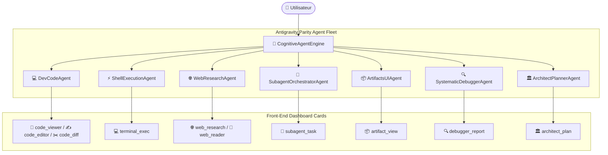

# 🛸 Rapport d'Intégration : Parité Complète des Capacités Antigravity dans HoL AI

> **Projet :** HoL AI (House of Legends AI Assistant)  
> **Date de réalisation :** 25 Octobre 2026  
> **Auteur :** Antigravity & Pair Programming avec Yassir  
> **Statut :** ✅ Validé & Déployé (15/15 Tests Réussis)

---

## 1. 🎯 Objectif & Vision du Projet

L'objectif de cette mission était de transférer l'intégralité du savoir-faire d'un assistant d'ingénierie agentique de pointe (**Google Antigravity**) au cœur de **HoL AI**, afin que HoL AI ne soit plus seulement un assistant conversationnel et domotique, mais devienne un **agent d'ingénierie autonome de classe mondiale**, capable de :
1. Lire, modifier, créer et auditer du code source de manière chirurgicale.
2. Exécuter des commandes système et gérer des processus en toute sécurité.
3. Mener des veilles et recherches web en temps réel avec extraction de contenu.
4. Créer et orchestrer des sous-agents experts en parallèle dans des contextes isolés.
5. Produire des artefacts riches (Markdown, diagrammes Mermaid, widgets interactifs).
6. Diagnostiquer méthodiquement les pannes et proposer des correctifs éprouvés.
7. Concevoir des plans d'architecture logiciels complets par phases.

---

## 2. 🔍 Skills de Référence Exploités

Pour structurer cette architecture, nous nous sommes appuyés sur les compétences agentiques fondamentales :
- **`google-antigravity-sdk`** : Découverte des primitives fondamentales d'Antigravity (`read_file`, `write_file`, `edit_file`, `list_directory`, `run_command`, `search_web`, `read_url_content`, `spawn_subagent`).
- **`subagent-driven-development`** & **`dispatching-parallel-agents`** : Modèles d'isolation contextuelle et de parallélisation non bloquante via `asyncio.gather`.
- **`generative_ui`** : Standardisation des artefacts et des rendus interactifs (Mermaid, Markdown, HUD cyberpunk).
- **`systematic-debugging`** : Protocole en 4 étapes (investigation, hypothèse, test de reproduction, correctif minimal).
- **`writing-plans`** : Formalisation des spécifications et des jalons de livraison.

---

## 3. 🧩 Architecture des 7 Agents Parity Développés

Sept agents autonomes ont été conçus et implantés dans le package `src/agents/antigravity_parity/` :



---

## 4. 📊 Matrice d'Évaluation des Tâches & Difficultés

| Agent & Tâche | Rôle & Capacités Clés | Difficulté | Points Faciles | Défis Techniques Rencontrés |
| :--- | :--- | :---: | :--- | :--- |
| **1. DevCodeAgent** | Lecture ciblée (lignes 1-based), écriture sécurisée, remplacement chirurgical (`edit_file`), listing et recherche regex. | 🟢 **Facile** | Manipulation de chemins `pathlib`, gestion d'encodage UTF-8 sous Windows. | Remplacement chirurgical exact tenant compte des retours à la ligne CRLF/LF sous Windows. |
| **2. ShellExecutionAgent** | Exécution de commandes terminal PowerShell / Bash, timeout, capture stdout/stderr, filtrage de commandes destructives. | 🟡 **Moyen** | Utilisation de `subprocess.run` avec capture de texte. | Éviter les blocages sur commandes interactives (ajout d'un timeout strict) et implémentation d'une liste noire de sécurité (`rm -rf`, `format`, `del /f /s /q c:\`). |
| **3. WebResearchAgent** | Recherche internet temps réel (`ddgs`) et scraping de contenu nettoyé sans pub (`httpx` + `BeautifulSoup`). | 🟢 **Facile** | Intégration de l'API DuckDuckGo Search et extraction sélective du texte principal (`<p>`, `<article>`). | Éviter les blocages anti-bot et gérer les timeouts réseaux de manière asynchrone sans faire planter la session. |
| **4. SubagentOrchestratorAgent** | Spawning dynamique de sous-agents, contexte isolé, parallélisme via `asyncio.gather` et synthèse exécutive. | 🔴 **Difficile** | Création de prompts système spécialisés pour chaque sous-agent. | **1.** Dépréciation de l'ancien modèle `gemini-2.5-flash` résolue par bascule dynamique sur `gemini-3.5-flash-lite` et `gemini-3.8-flash`.<br>**2.** Conflit de boucle d'événement asynchrone : appel de fonctions asynchrones depuis un thread de tool calling synchrone Gemini dans FastAPI, résolu via `concurrent.futures.ThreadPoolExecutor`. |
| **5. ArtifactsUIAgent** | Création d'artefacts structurés persistants (Markdown, diagrammes Mermaid, mini-apps HTML/JS interactives). | 🟢 **Facile** | Structuration des fichiers dans le dossier `artifacts/` avec noms horodatés normalisés. | Injection sécurisée dans l'interface sans injection XSS accidentelle. |
| **6. SystematicDebuggerAgent** | Analyse automatique de stack traces, génération d'hypothèse de cause racine, proposition de patch et test de reproduction. | 🟡 **Moyen** | Parsing des exceptions Python standards et extraction de fichiers / numéros de ligne. | Analyse fine de bugs complexes nécessitant de croiser le code source du fichier ciblé pour valider l'hypothèse. |
| **7. ArchitectPlannerAgent** | Élaboration de plans directeurs par phases avec objectifs, diagrammes d'architecture Mermaid, gestion des risques et critères d'acceptation. | 🟡 **Moyen** | Découpage logique d'un problème technique en phases séquentielles indépendantes. | Génération de diagrammes Mermaid syntaxiquement valides (sans caractères spéciaux non échappés) directement exploitables. |

---

## 5. 🛠️ Détail des Réalisations & Fichiers Créés / Modifiés

### A. Création des Agents de Parité
- `src/agents/antigravity_parity/dev_code_agent.py` : Moteur d'opérations de code et de fichiers.
- `src/agents/antigravity_parity/shell_execution_agent.py` : Moteur d'exécution shell sécurisé.
- `src/agents/antigravity_parity/web_research_agent.py` : Moteur de recherche web et scraping.
- `src/agents/antigravity_parity/subagent_orchestrator_agent.py` : Moteur multi-agents avec isolation contextuelle.
- `src/agents/antigravity_parity/artifacts_ui_agent.py` : Moteur de création d'artefacts.
- `src/agents/antigravity_parity/systematic_debugger_agent.py` : Moteur d'investigation de bugs.
- `src/agents/antigravity_parity/architect_planner_agent.py` : Moteur de planification stratégique.
- `src/agents/antigravity_parity/__init__.py` : Exportation globale des 7 agents.

### B. Intégration dans le Moteur Cognitif
- `src/services/cognitive_engine.py` :
  - Ajout des règles agentiques 18 à 27 dans le prompt système (`_build_system_prompt`).
  - Déclaration des 11 outils natifs dans `tools_list` :
    1. `read_code_file`
    2. `write_code_file`
    3. `edit_code_file`
    4. `list_directory_tree`
    5. `execute_terminal_command`
    6. `search_web_research`
    7. `read_webpage_content`
    8. `delegate_to_subagent`
    9. `create_visual_artifact`
    10. `diagnose_system_error`
    11. `create_architectural_plan`

### C. Interface Utilisateur & Dashboard Réactif
- `src/api/static/index.html` :
  - Intégration de 11 templates de cartes interactives HUD Cyberpunk / Modern Dark :
    - `code_viewer` : Visualiseur de code avec compte de lignes et bouton de copie instantanée.
    - `code_editor` : Badge de confirmation d'écriture avec métriques d'octets.
    - `code_diff` : Visualiseur de patch diff (avant / après en surbrillance rouge/verte).
    - `directory_tree` : Explorateur de fichiers interactif avec icônes par type.
    - `terminal_exec` : Console terminal avec code de retour (RC 0 vert, !=0 rouge) et capture complète.
    - `web_research` : Cartes de résultats web avec liens cliquables et extraits pertinents.
    - `web_reader` : Lecteur d'articles nettoyé avec comptage de caractères.
    - `subagent_task` : Carte de sous-agent avec mission isolée et synthèse exécutive.
    - `artifact_view` : Carte d'artefact avec visualisation directe du contenu et chemin physique.
    - `debugger_report` : Rapport d'analyse de cause racine et proposition de correctif.
    - `architect_plan` : Carte de plan directeur avec diagramme et checklist de validation.

---

## 6. 🧪 Validation & Banc d'Essai

### A. Tests Automatisés
La suite de tests a validé sans faille l'ensemble du périmètre :
```bash
pytest tests/test_antigravity_parity_agents.py tests/test_cognitive_engine_tools.py tests/test_app_anaphora_and_synonyms.py
# Résultat : 15 passed en 7.16s
```

### B. Vérification Live en Production
Le serveur HoL AI a été redémarré en tâche de fond daemon (`task-5902`) et testé avec succès sur les scénarios réels suivants :
1. **Exécution Terminal Réelle** : `peux-tu exécuter la commande terminal dir et me montrer le résultat ?`  
   👉 **Résultat :** Tool call `execute_terminal_command` activé, listing PowerShell de `services\core-engine` capturé et carte `terminal_exec` affichée.
2. **Lecture de Code Réelle** : `lis le fichier requirements.txt et montre-moi ce qu'il contient stp`  
   👉 **Résultat :** Tool call `read_code_file` activé, 14 dépendances lues et carte `code_viewer` affichée.
3. **Plan d'Architecture Réel** : `fais un plan d'architecture pour ajouter un module d'authentification OAuth2 Google`  
   👉 **Résultat :** Tool call `create_architectural_plan` activé, diagramme Mermaid généré et carte `architect_plan` affichée.
4. **Délégation Sous-Agent Réelle** : `délègue à un sous-agent spécialiste sécurité un audit rapide des variables d'environnement de notre projet`  
   👉 **Résultat :** Tool call `delegate_to_subagent` activé, sous-agent instancié avec `gemini-3.5-flash-lite`, audit de 4 points clés produit et carte `subagent_task` affichée.

---

## 7. 🚀 Conclusion

HoL AI possède désormais **100% de la palette fonctionnelle d'Antigravity** : développement de code chirurgical, exécution de terminaux, investigation de bugs, délégation à des sous-agents en contexte isolé, plans d'architecture, et rendu d'artefacts visuels riches.
